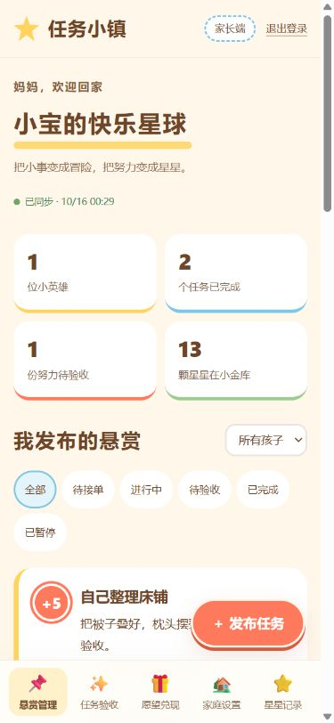

# 任务小镇 · Task Town

家长发布任务，孩子领取并提交打卡，家长验收通过后发放星星，再用星星兑换约定的小愿望。家长与孩子使用独立页面和账号，界面优先适配手机浏览器。

**在线体验：** [任务小镇](https://task-town-family.shrewdmoose128.chatgpt.site/)

[家长入口](https://task-town-family.shrewdmoose128.chatgpt.site/parent) · [孩子入口](https://task-town-family.shrewdmoose128.chatgpt.site/kid)

首次使用请在家长端创建家庭，再添加孩子，取得家庭码、孩子账号和六位口令。

## 功能

- 家长发布单次或每日任务，设置奖励、截止时间和照片要求。
- 孩子领取任务、填写打卡留言、上传照片，等待家长验收。
- 家长验收通过或退回重做；奖励由后端发放，重复验收不会重复发奖。
- 愿望上架、兑换扣星、家长兑现或退还星星。
- 独立的家庭与孩子权限、成长记录、星星流水和家庭记录导出。
- 手机底部导航、任务发布弹窗、单列卡片和安全区域适配。

## 两个版本

| 目录 | 后端与存储 | 用途 |
| --- | --- | --- |
| [task-town](task-town/) | Node.js + MySQL 8 | 本地运行、家庭试用、后续自行部署 |
| [task-town-sites](task-town-sites/) | Cloudflare Workers / Vinext + D1 + R2 | Sites 托管线上版 |

两个版本使用独立数据库，账号与业务数据不自动同步。手机 App 和原生手表端尚未制作。

## 本地 MySQL 版快速开始

准备 Node.js 22.13 或以上版本与 MySQL 8，将 `mysqld` 加入 PATH；也可通过 `MYSQLD_PATH` 指定其可执行文件。

```sh
cd task-town
npm ci
npm run setup:local
npm start
```

`setup:local` 创建项目专属的 MySQL 实例和随机数据库密码，默认使用 `127.0.0.1:3307`，不修改已有 MySQL 系统服务。网站默认使用端口 `3000`。

启动后访问 [家长端](http://127.0.0.1:3000/parent.html) 或 [孩子端](http://127.0.0.1:3000/kid.html)。手机和电脑连接同一 Wi-Fi，使用启动窗口显示的电脑局域网地址访问。

更多说明见 [本地版 README](task-town/README.md) 和 [API 文档](task-town/docs/API.md)。

## Sites 线上版

网页位于 `task-town-sites/public/`，接口位于 `task-town-sites/lib/town-api.mjs`，数据库结构和迁移位于 `db/`、`drizzle/`。

```sh
cd task-town-sites
npm ci
npm run build
node --test tests/cloud.test.mjs
```

本仓库不包含现有站点的部署身份。部署自己的 Sites 项目时，应创建自己的站点，将其项目 ID 配置到 `.openai/hosting.json`，并绑定 D1 `DB` 和 R2 `BUCKET`。详见 [线上版说明](task-town-sites/README.md)。

## 检查和测试

本地版提供 `npm run check` 和基于真实 MySQL 的 `npm test`；后者需要先运行 `npm run setup:local`。线上版的集成测试使用临时 Miniflare D1 / R2，覆盖任务流程、并发奖励、兑换退款、照片权限、密码会话和每日任务。

仓库只包含源码、数据库结构、测试与说明，不包含运行中的账号数据、照片原文件、会话、备份、数据库密码或本地 `.env`。


