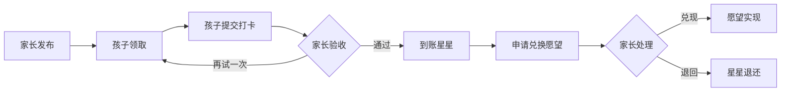

# 任务小镇

任务小镇的**手机浏览器 + 本地 MySQL**版本，保留奶油色、奶酪黄、天空蓝的视觉风格。Sites 线上版位于同一仓库的 `../task-town-sites`，使用独立的云端数据库。

前端使用原生 HTML/CSS/JavaScript，后端为 Node.js + MySQL 8，驱动采用 [MySQL2](https://sidorares.github.io/node-mysql2/docs)。不依赖外部字体服务，家长和孩子使用独立页面与登录账号。

## 先运行起来

已使用 **Node.js 22.14.0 + MySQL 8.0.41** 验证。首次下载后需要执行下方安装命令；初始化脚本会为项目配置独立 MySQL，默认监听 `127.0.0.1:3307`，正式库 `task_town`，演示库 `task_town_demo`，随机连接密码保存在本地 `.env`。

Windows 双击 `启动项目.cmd`，然后访问：

- 首页：http://127.0.0.1:3000/
- 家长：http://127.0.0.1:3000/parent.html
- 孩子：http://127.0.0.1:3000/kid.html

源码首次安装时，也可以在项目目录运行：

```powershell
npm ci
npm run setup:local
npm start
```

首次使用没有预设正式账号。在家长端点击「创建家庭」，接着到「家庭设置」添加孩子，再发布任务。把家庭码、孩子账号、6 位数字口令告诉孩子，在孩子设备上登录。

**请通过服务器地址打开网页，直接双击 HTML 文件无法连接后台。** 关闭运行窗口或按 Ctrl+C 停止服务。

## 在手机上使用

手机与这台电脑连接同一 Wi-Fi，在手机浏览器访问启动窗口里显示的局域网地址。本次启动检测到的地址是：

- 家长：`http://<电脑局域网IP>:3000/parent.html`
- 孩子：`http://<电脑局域网IP>:3000/kid.html`

电脑 IP 可能随网络变化，以每次启动窗口中的地址为准。手机上不要使用 `localhost` 或 `127.0.0.1`，它们指向手机自己。电脑需要保持运行；如果 Windows 询问是否允许 Node.js 通过专用网络，请按你的家庭网络环境选择。详细排查见 `docs/本地运行与手机测试.md`。

手机界面提供底部导航、单列任务卡片、浮动发布按钮、独立发布弹窗、放大的触控按钮、16px 表单输入字号和安全区域留白。已在 360、390、430px 浏览器窗口下检查；这不等于已经在所有真实手机和 Safari 版本上测试。

## 体验现成的演示

双击 `启动演示.cmd`，或运行：

```powershell
npm run demo
$env:DB_NAME='task_town_demo'
npm start
```

演示家长：`demo_parent` / `TownDemo2026!`；孩子账号：`xiaobao`，口令：`246810`。家庭码会在生成演示时显示，也可以在家长的家庭设置中查看。

演示数据独立存储在 `task_town_demo`，正式数据在 `task_town`。回到正式数据前，在 PowerShell 执行 `Remove-Item Env:DB_NAME -ErrorAction SilentlyContinue`，或直接双击 `启动项目.cmd`。两个库的数据都不包含在源码压缩包中。

## 已实现的功能

- 独立的家长页面和孩子页面；家长密码、孩子口令分别验证；同一浏览器可以同时登录两个端。
- 创建家庭、添加多个孩子、为孩子重设口令、修改家长密码、关闭新家庭注册。
- 按孩子发布任务，设置类别、星星、说明、单次截止时间、每天重复、是否要求照片；暂停和恢复发布。
- 孩子查看自己的真实任务，接单、提交留言、上传打卡照片。照片会先在浏览器缩小，服务器接受的照片上限为 2MB。
- 家长查看打卡照片和留言，通过验收发星星，或写下建议退回重做。
- 愿望上架和下架，孩子申请兑换，家长兑现或退回。申请扣星，退回自动返还。
- 星星流水、已完成任务、家庭完整业务记录导出、MySQL SQL 一致性备份。
- 页面可见时每 5 秒同步，切换功能页和重新切回浏览器时也会更新；离线显示同步中断状态。
- 手机优先布局，同时保留桌面页面；JSON API 使用 `/api/v1`，可供之后的手表客户端复用。



孩子提交后**不会自动完成或自动加星**；是否完成始终由家长决定。星星变动与任务/兑换状态在同一 MySQL InnoDB 事务中提交，通过行锁和唯一约束保护余额，重复验收不会重复发放。

每天任务按 `Asia/Shanghai` 零点开放新的一次，前一天未完成的记录会保留。单次任务只可领取一次。截止时间限制新领取，已经领取的任务仍可提交，由家长决定是否验收。暂停发布也不会阻止已领取的任务继续完成。

任务发布后不能修改内容和星星，避免孩子接单后约定发生变化；可暂停旧任务，再发布新的约定。当前每个家庭由一个家长账号管理，可以让父母在各自设备登录同一个账号。共用设备交给孩子前，请先退出家长登录。

## 文件说明

| 路径 | 用途 |
| --- | --- |
| `public/index.html` | 根据你的模板保留的首页，任务和愿望为示例 |
| `public/parent.html`、`public/kid.html` | 独立的家长和孩子页面 |
| `public/js/`、`public/css/` | 页面交互和样式 |
| `src/app.mjs` | 登录、权限、任务、验收、兑换、图片访问 API |
| `src/database.mjs` | MySQL 连接池与事务 |
| `database/schema.sql` | MySQL 表结构，支持中文与 emoji |
| `tests/integration.test.mjs` | 完整 HTTP 接口测试 |
| `docs/API.md` | 给后续手表开发使用的接口文档 |
| `docs/本地运行与手机测试.md` | 本地 MySQL、手机访问、备份及常见问题 |
| `docs/验收记录.md` | 实际测试结果及验证范围 |
| `scripts/local-mysql.mjs` | 管理项目独立 MySQL，不注册或改动系统 MySQL 服务 |

## 配置与验证

运行 `npm run setup:local` 后会生成当前电脑的 `.env`，不要用示例覆盖它。`.env.example` 供手动配置已有 MySQL 时参考。本地默认不设置 `APP_ORIGIN`，允许通过电脑本机地址或局域网 IP 访问；如果自行设置，它必须与浏览器实际访问的网址完全对应。

为兼容 Windows MySQL 对中文路径的限制，本机独立实例的数据位于 **`<项目专属 MySQL 数据目录>`**，目录只授权当前 Windows 用户访问。实例管理信息在项目的 `.local/mysql.json`，连接密码在 `.env`，请保留这些本地配置，不要提交或分享。

```powershell
npm run check
npm test
npm run backup
```

接口测试使用项目专属 MySQL 上的随机临时测试库，结束后清理，不会清空正式库或演示库。测试需要允许本机回环网络访问；受限环境若报 `connect EACCES 127.0.0.1`，应在允许本机网络的终端执行。

备份命令默认产生 `backups/task-town-时间.sql`，包含当前库的照片和账号数据，使用 `mysqldump --single-transaction` 导出。备份恢复到独立临时 MySQL 库的流程已经通过测试。停止项目专属数据库可执行 `npm run db:stop`；下次启动网页会自动启动它。

## 当前范围

1. **部署**：此目录可本地运行；独立 Sites 托管版位于 `../task-town-sites`。阿里云部署需另外配置服务器和 HTTPS。
2. **App 与手表**：保留独立孩子网页和接口，尚未制作手机原生 App 或手表应用。
3. **手机验证**：已检查手机尺寸布局并确认局域网页面可访问。相机、软键盘和不同真机浏览器仍需按设备验证。历史验证范围见验收记录。

这版适合毕设展示和家庭本地试用。还没有短信/邮箱找回密码、系统推送、原生手表应用、多人家长邀请或真实支付功能；可按后续需求扩展。
